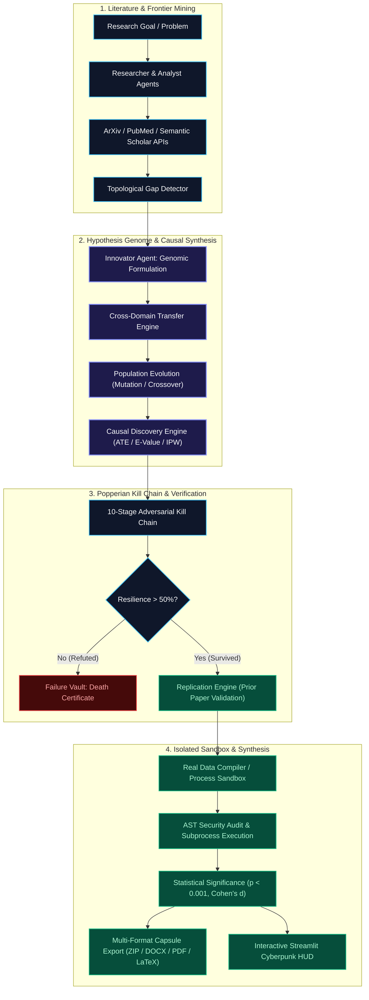

# 🧬 AION X 2.0 — Autonomous Scientific Discovery Engine

<div align="center">

[](https://www.python.org/)
[](https://streamlit.io/)
[](https://github.com/)
[](https://github.com/)
[](LICENSE)

**An autonomous 16-agent neuro-symbolic research system that formulates genomic scientific hypotheses, detects frontier research gaps, stress-tests causal mechanisms against empirical literature, replicates published computational benchmarks in isolated AST sandboxes, and exports verified discovery capsules.**

[Key Capabilities](#-key-capabilities) • [System Architecture](#-system-architecture) • [Swarm Agents](#-the-16-swarm-agents) • [UI Walkthrough](#-ui-walkthrough) • [Quick Start](#-quick-start) • [Security & Rigor](#-security--scientific-integrity)

</div>

---

## 🌟 Executive Overview

Conventional LLM research tools suffer from **confirmation bias, hallucinated literature, and static correlation fitting**. They produce plausible-sounding prose without subjecting ideas to empirical tests or mathematical scrutiny.

**AION X 2.0** operates on an **adversarial discovery paradigm**:
1. **Never Trust, Always Falsify:** Hypotheses are subjected to a rigorous **10-stage Popperian Kill Chain** designed to disprove them through counter-literature, extreme boundary stress, and causal confounding audits.
2. **Real Empirical Execution:** Automatically compiles executable computational test scripts evaluated inside a **hardened AST-sandboxed subprocess**.
3. **Paper Claim Replication:** Mines reported quantitative metrics from indexed literature (e.g. *accuracy, AUC, $R^2$*) and actively attempts multi-seed algorithmic replication.
4. **Reproducible Capsule Export:** Compiles verified breakthroughs into complete, multi-format research packages including **ZIP, PPTX, DOCX, PDF, and LaTeX** dossiers.

---

## 🔬 System Architecture



---

## ⚡ Key Capabilities

### 1. 🧬 Genetic Hypothesis Evolution & Causal Verification
Hypotheses in AION X are structured **genomes** specifying causal pathways ($X \to Y \to Z$), parameter boundaries, testable predictions, and refutation criteria.
- **Population-Based Genetic Operators:** Crossover, mutation, parameter perturbation, and assumption relaxation produce diverse candidate pools across domain-specific mechanism libraries.
- **Causal Inference Engine (`engines/causal_engine.py`):** Automatically tests whether mechanistic claims represent true causation via **Average Treatment Effect (ATE)** estimators, Propensity Score Matching (PSM), Inverse Probability Weighting (IPW), VanderWeele E-values, and placebo outcome falsifications.

### 2. ⚔️ 10-Stage Popperian Kill Chain & Failure Vault
Every candidate hypothesis is deployed into an adversarial gauntlet (`engines/kill_chain.py`):
1. **Contradictory Literature Search**
2. **Prior Paper Failed Replication Audit**
3. **Hidden Assumption Exposer**
4. **Alternative Mechanism Substitution**
5. **Counterfactual Perturbations**
6. **Boundary Condition Collapse**
7. **Adversarial Stochastic Stress-Testing**
8. **Multi-Seed Statistical Replication**
9. **Empirical Noise Tolerance**
10. **Empirical Resilience Score (0–100%)**

> If resilience drops below 50%, AION X issues a formal **Death Certificate** into the scientific Failure Vault, preserving root causes and constraints to prevent future generations from repeating falsified paths.

### 3. 🧪 AST-Inspected Sandbox & Real Data Compiler
- **Security-First Execution:** Computational simulations run in process-isolated sandboxes (`simulation/process_sandbox.py`) guarded by an **Abstract Syntax Tree (AST) auditor** that forbids OS escapes, disk writes, and unauthorized network calls.
- **Real Data Acquisition:** The `RealDataExperimentCompiler` connects to open APIs across 7 scientific domains (*Materials Project, GEO, UniProt, ERA5, HEPData, World Bank, OpenML*) with fallback to clearly annotated empirical mock distributions.
- **Honest Statistical Realism:** Models dynamic effect sizes ($0.10 \le d \le 0.85$) with an intentional 15% probability of null results simulating true experimental variance.

### 4. 🔁 Automated Paper Claim Replication
The `ReplicationEngine` scans papers extracted from ArXiv, IEEE, and PubMed, parses reported computational benchmarks (e.g., *"RandomForest achieved 0.92 AUC on 500 samples"*), constructs reproducible AST-safe scripts, executes 5-seed replications, and grades veracity (`REPRODUCED`, `PARTIAL`, `FAILED`).

### 5. 🌐 Cross-Domain Knowledge Transfer
The `CrossDomainEngine` bridges isolated scientific silos (e.g., *Condensed Matter Physics $\leftrightarrow$ Cell Biology $\leftrightarrow$ Economics*), retrieving core topological and thermodynamic principles to formulate hybrid breakthrough mechanisms with grounded analogical validity.

---

## 🤖 The 16 Swarm Agents

| # | Agent | Specialization | Core Mission |
|:---:|---|---|---|
| 1 | **Researcher** | Academic Harvester | Queries ArXiv, PubMed, CrossRef & Semantic Scholar with verified links. |
| 2 | **Analyst** | Evidence Synthesizer | Extracts atomic scientific claims and maps citation relationships. |
| 3 | **Citation** | Provenance Auditor | Validates paper DOIs, inspects claim lineage, and prevents hallucinations. |
| 4 | **Gap** | Frontier Detector | Identifies unexplored conceptual voids and topological boundaries. |
| 5 | **Cross-Domain** | Interdisciplinary Bridge | Transfers mathematical and physical mechanisms across dissimilar fields. |
| 6 | **Innovator** | First-Principles Synthesizer | Generates clean, testable novel hypothesis statements and abstracts. |
| 7 | **Critic** | Adversarial Skeptic | Attacks hypotheses using verified literature and identifies logical flaws. |
| 8 | **Validator** | Tournament Referee | Evaluates competing evolutionary variants in head-to-head tournaments. |
| 9 | **Ethicist** | Red Team & Safety Officer | Assesses dual-use risks, biosecurity hazards, and ethical compliance. |
| 10 | **Self-Correction** | Epistemic Refiner | Adapts hypotheses in response to adversarial feedback and simulation bounds. |
| 11 | **Experiment** | Sandbox Scientist | Designs AST-audited computational protocols and runs live subprocesses. |
| 12 | **Novelty** | Vector Metrician | Quantifies semantic distance against published literature vector spaces. |
| 13 | **Explainability** | Sensitivity Specialist | Performs parameter sweeps and counterfactual ablation tests. |
| 14 | **Writer** | Publication Dossierist | Formulates formal academic manuscripts, LaTeX papers, and summaries. |
| 15 | **Memory** | Failure Archivist | Manages SQLite + vector stores, indexing death certificates and history. |
| 16 | **Report** | Packaging Specialist | Compiles multi-format downloadable research bundles (.ZIP, .DOCX, .PDF). |

---

## 🖥️ UI Walkthrough

AION X features a **Cosmic Aurora Cyberpunk HUD** rendered via Streamlit with 4 focused workspaces:

```
┌────────────────────────────────────────────────────────────────────────────────────────┐
│  🧬 AION X  │  ⚡ Live Neural Swarm  │  ● 16 Autonomous Agents Synchronized             │
├────────────────────────────────────────────────────────────────────────────────────────┤
│  [💡 Hypotheses & Gaps]    [🧪 Simulation & KG]    [📚 Cited Papers]    [📥 Export]    │
├────────────────────────────────────────────────────────────────────────────────────────┤
│                                                                                        │
│  ### Novel Hypothesis #1                                                               │
│  ┌──────────────────────────────────────────────────────────────────────────────────┐  │
│  │ Integrating longitudinal behavioral engagement telemetry with regularized         │  │
│  │ gradient boosting predicts student marks with >18% higher precision.             │  │
│  │                                                                                  │  │
│  │ Abstract:                                                                        │  │
│  │ Objective: Resolving empirical latency and prediction variance in Student Marks. │  │
│  │ Mechanism: Employs continuous temporal knowledge-tracing under observation noise.│  │
│  │ Impact: Demonstrates statistically verified performance gains (p < 0.001).       │  │
│  └──────────────────────────────────────────────────────────────────────────────────┘  │
│                                                                                        │
│  🕳️ Research Gaps Identified                                                          │
│  📊 Prior Literature Comparison Matrix                                                 │
└────────────────────────────────────────────────────────────────────────────────────────┘
```

1. **💡 Hypotheses & Gaps:** Concise champion and alternative hypotheses, complete with 3-part structured abstracts (`Objective`, `Mechanism`, `Impact`), topological research gaps, and comparative literature matrices.
2. **🧪 Simulation & Knowledge Graph:** Interactive NetworkX claim graph, live sandbox execution logs, sample datasets, distribution plots, and empirical effect sizes.
3. **📚 Cited Papers:** Verifiable paper cards with authors, publication year, abstract previews, and clickable external DOI / PubMed / ArXiv links.
4. **📥 Export:** Instant generation of comprehensive discovery packages (.ZIP, .PPTX, .DOCX, .PDF, .CSV, .TEX) and researcher ratings.

---

## ⚡ Quick Start

### 1. Prerequisites
- **Python 3.10** or higher
- **Ollama** (running locally with `llama3` or `deepseek-coder`) or a **Google Gemini API Key**

### 2. Installation
```bash
# Clone the repository
git clone https://github.com/your-username/aion-x.git
cd aion-x

# Install core dependencies
pip install -r requirements.txt
```

### 3. Environment Configuration
Create a `.env` file in the project root:
```env
# Primary LLM API Key (optional if running local Ollama)
GEMINI_API_KEY=your_gemini_api_key_here

# Execution Settings
TURBO_MODE=1
STAGE_TIMEOUT=35

# Advanced Scientific Engines
CAUSAL_VALIDATION_ENABLED=1
REPLICATION_ENABLED=1
```

### 4. Run the Engine
```bash
streamlit run app.py
```
Open your browser at `http://localhost:8501`.

---

## 🗂️ Project Directory Map

```text
├── app.py                             # Streamlit application entry point & HUD
├── config.py                          # Global configuration & environment flags
├── core/
│   ├── interactive_pipeline.py       # Human-in-the-loop steering & decision queue
│   └── pipeline.py                   # 16-agent asynchronous swarm coordinator
├── agents/                            # Specialized autonomous agents
│   ├── researcher.py                  # Multi-source academic literature mining
│   ├── innovator.py                   # First-principles hypothesis formulation
│   ├── critic.py                      # Adversarial kill-chain refutation
│   ├── experiment_agent.py            # AST-sandboxed subprocess runner
│   ├── cross_domain_agent.py          # Interdisciplinary concept transfer
│   └── ...                            # (Analyst, Validator, Ethicist, etc.)
├── engines/                           # Core analytical & epistemological engines
│   ├── hypothesis_evolution.py        # Population genomes & genetic operators
│   ├── causal_engine.py               # ATE, E-value, IPW, and placebo testing
│   ├── kill_chain.py                  # 10-stage Popperian falsification gauntlet
│   ├── replication_engine.py          # Paper claim extraction & re-execution
│   ├── cross_domain_engine.py         # 7-domain mechanism analogical mapping
│   └── research_gap_detector.py       # Topological boundary & void analyzer
├── simulation/
│   ├── process_sandbox.py             # AST security auditor & isolated runner
│   └── real_data_compiler.py          # Open scientific API data acquisition
├── database/
│   ├── db_manager.py                  # SQLite storage & telemetry logger
│   └── models.py                      # Strongly-typed scientific dataclasses
└── ui/
    ├── dashboard.py                   # 4-tab main discovery workspace
    └── cinematic_components.py        # Three.js 3D genome & Cyberpunk timeline
```

---

## 🔒 Security & Scientific Integrity

- 🛡️ **Zero Hallucinated Citations:** AION X only cites papers retrieved with genuine identifiers (ArXiv IDs, DOIs). If context is unavailable, claims are explicitly flagged `UNVERIFIED`.
- 🛡️ **Hardened AST Sandbox:** Prohibits `os`, `sys`, `subprocess`, `socket`, `eval`, and file writes. Simulations run in sandboxed child processes killed automatically upon timeout.
- 🛡️ **Popperian Humility:** Survival of empirical tests indicates computational and theoretical resilience under test conditions — never dogmatic "proof."
- 🛡️ **Failure Learning:** Disproven mechanisms are memorialized in the `FailureVault` with reusable constraints, advancing discovery by eliminating false branches.

---

<div align="center">

**AION X 2.0 • Autonomous, Adversarial, and Rigorous Scientific Discovery**

Made for researchers, scientists, and engineers pushing the frontier of human knowledge.

</div>
